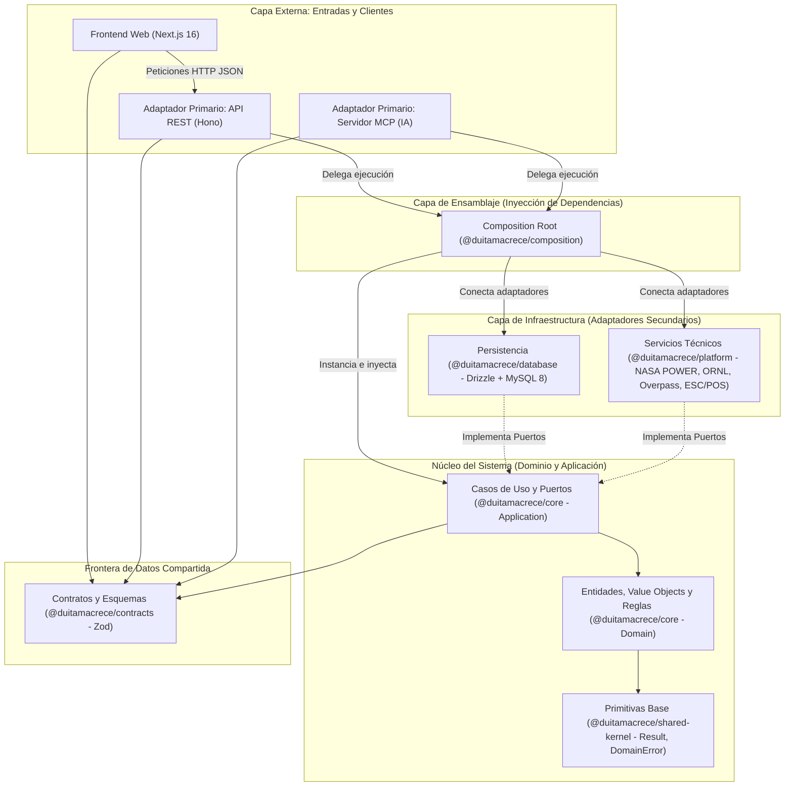
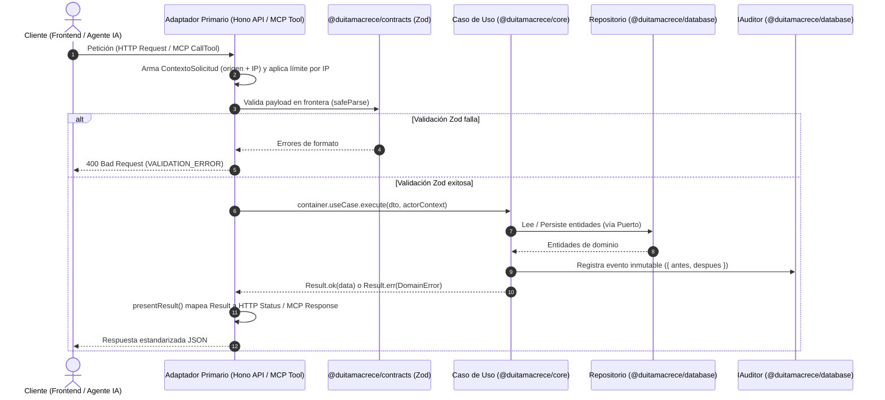

# 🏛️ Reglas de Arquitectura Limpia — DuitamaCrece

> **Documento de Referencia Arquitectónica (Clean Architecture + Domain-Driven Design)**
> Describe cómo está organizado el monorepo de **DuitamaCrece**, cómo interactúa cada capa en tiempo de ejecución y cuáles son las reglas obligatorias que preservan la pureza del dominio.

---

## 1. Filosofía Arquitectónica

**DuitamaCrece** está diseñado bajo los principios de **Clean Architecture (Arquitectura Limpia)**, **Arquitectura Hexagonal (Puertos y Adaptadores)** y **Domain-Driven Design (DDD) táctico**.

El objetivo central es **aislar las reglas de negocio** de cualquier detalle técnico externo (base de datos MySQL, framework HTTP Hono, protocolo MCP de IA o interfaz Next.js).

---

## 2. Flujo de una Petición (Adaptadores Primarios)

---

## 3. Las 7 Reglas de Oro de esta Arquitectura (No Negociables)

Para evitar la degradación arquitectónica (acoplamiento espagueti), todo código nuevo o modificación debe cumplir estas **7 reglas estrictas**:

### Regla 1: Ley de Dependencia Estricta (Matriz de Importaciones)
Las dependencias **siempre apuntan hacia adentro** (hacia `core` y `shared-kernel`). Ninguna capa interna puede saber nada de una capa externa.

| Paquete / Capa | ✅ Puede importar de | ❌ PROHIBIDO importar de |
| :--- | :--- | :--- |
| **`shared-kernel`** | *(Ninguno — TypeScript puro)* | Cualquier paquete o librería externa |
| **`Shared/contracts`** | `zod` | `core`, `database`, `platform`, `api`, `Frontend` |
| **`core`** | `shared-kernel`, `Shared/contracts` | `database` (Drizzle/MySQL), `platform` (HTTP a proveedores, impresora), `api` (Hono), `composition` |
| **`database`** | `core`, `shared-kernel`, `drizzle-orm`, `mysql2` | `platform`, `composition`, `api`, `mcp-server` |
| **`platform`** | `core`, `shared-kernel`, `Shared/contracts` | `database`, `composition`, `api`, `mcp-server` |
| **`composition`** | `core`, `database`, `platform`, `shared-kernel`, `Shared/contracts` | `api`, `mcp-server`, `Frontend` |
| **`apps/api` y `mcp-server`** | `composition`, `core` *(solo tipos/errores)*, `shared-kernel`, `Shared/contracts` | `database` (repositorios/Drizzle directo), `platform` directo |
| **`Frontend`** | `Shared/contracts`, librerías React/Next.js | **Cualquier paquete de `Backend/`** |

---

### Regla 2: Pureza Absoluta de `core`
* En `Backend/packages/core` está **terminantemente prohibido** importar `drizzle-orm`, `mysql2`, `hono`, `jose`, `argon2`, `nodemailer` o usar `Deno.env` directamente.
* Si un caso de uso necesita llamar a un proveedor externo, imprimir, consultar la hora o ejecutar una transacción SQL, debe definir una **interfaz (Puerto)** en `core` e inyectarla por constructor.

---

### Regla 3: Prohibición de Excepciones para Flujo de Negocio (`Result<T, DomainError>`)
* Ninguna regla de negocio fallida (ej. finca duplicada, coordenadas inválidas, área demasiado grande) puede lanzar `throw new Error(...)`.
* Todo fallo de dominio esperado debe devolverse como `Result.err(new DomainError('CODIGO', 'Mensaje'))`.
* Las excepciones (`try/catch`) solo se usan en los adaptadores de infraestructura (`database`, `platform`, `safeHandler`) para atrapar fallos técnicos catastróficos (caída de red MySQL, timeout de un proveedor externo).

---

### Regla 4: Prohibición de Instanciación Manual fuera de `composition`
* Ningún controlador de `apps/api` ni herramienta de `apps/mcp-server` puede hacer `new MySqlFincaRepository(...)` ni `new CrearFincaUseCase(...)`.
* Todo caso de uso se registra en `Backend/packages/composition/src/container.ts` (`createContainer`) y se consume ya ensamblado desde `AppContainer`.

---

### Regla 5: Validación Obligatoria en la Frontera con Zod
* Ningún dato proveniente del exterior (body JSON, query params, parámetros de rutas o argumentos de herramientas MCP) puede entrar a un caso de uso sin pasar primero por un esquema Zod de `@duitamacrece/contracts`.
* Tampoco se deben duplicar validaciones de negocio complejas en los controladores: el controlador valida la **estructura** con Zod y el caso de uso valida las **invariantes del negocio**.

---

### Regla 6: Auditoría Transversal e Inmutabilidad (`IAuditor`)
* Todo caso de uso que **cree, actualice, anule o cambie el estado** de una entidad debe inyectar el puerto `IAuditor` y registrar la operación.
* El detalle de auditoría sigue el contrato `{ antes: {...}, despues: {...} }` registrando únicamente los campos afectados.
* **Sanitización obligatoria:** Jamás se registran en auditoría contraseñas, secretos ni tokens de acceso (se filtran mediante `sanitizarDetalles`).

---

### Regla 7: Respeto a las Reglas de Integridad de Base de Datos
* **Tablas Append-Only:** `movimientos_inventario` (Kardex) y `logs_auditoria` son estrictamente inmutables (protegidas por triggers en MySQL que bloquean `UPDATE` y `DELETE`).
* **Correcciones contables y de stock:** Una entrada de inventario o venta equivocada nunca se borra ni se edita en el Kardex; se compensa insertando un nuevo movimiento inverso (`ajuste_entrada`, `ajuste_salida`, `anulacion_entrada`, `devolucion_venta`).
* **Sede Principal Reservada:** La sucursal con `id_sucursal = 1` (*Sede Principal - Sistema*) es estructural y no puede ser inactivada ni eliminada.
